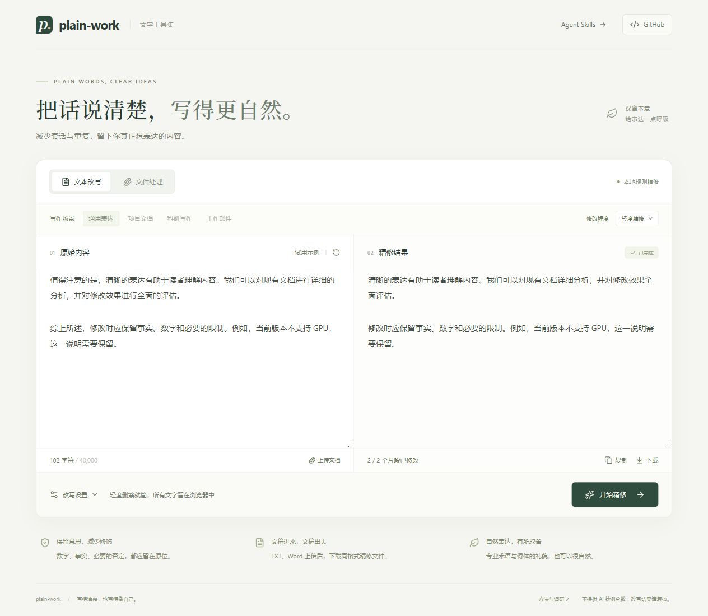

# plain-work

降 AI 味工具集：网页精修文本与文档，也提供可独立使用的 Agent Skills。

plain-work 希望让内容更具体、表达更自然，同时保留事实、必要限定和作者自己的语气。项目从“不是 X，而是 Y”这类反复出现的句式出发，逐步整理套话、空泛结论、关系错位和项目质量问题。

## 工具

| 工具 | 用途 | 入口 |
| --- | --- | --- |
| 文字精修网站 | 输入文字，或上传 TXT、Word，查看结果并下载同格式文件 | [网站源码与启动说明](web/README.md) |
| Agent Skills | 在 agent 中按领域生成、审阅和改写 | 下方五个技能目录 |
| 调研与案例 | 了解常见表现、保留反例与评估方法 | [调研报告](docs/research.md) |

## 文字精修网站

[打开网站](https://plain-work-editor.lucifer07.chatgpt.site) · 当前为所有者私有预览，网站源码公开。



- **文本**：输入框内粘贴或输入，结果直接显示在右侧，可复制或下载 TXT。
- **文件**：支持 `.txt` 和 `.docx`，输出同格式的 `原文件名-精修` 附件。旧版 `.doc` 请先另存为 `.docx`。
- **规则精修**：无需密钥，在浏览器中轻度处理冗余表达；不是段落级模型重写，未发现安全修改项时保留原文。
- **DeepSeek 深度改写**：在“改写设置”中临时填写自己的 API Key，按通用、文档、科研或邮件场景改写；费用由用户自己的模型账户承担。
- Word 保留原有段落、表格、图片与字符样式；含字段、公式、修订等特殊内容的段落会跳过。文字长度变化可能影响分页，结果需复核。

本版没有真实收款或运营方公共模型额度。接入大模型的操作步骤见[网站说明](web/README.md)，收费方案与后续建设见[产品方案](docs/product-plan.md)。

## Skills

五个自包含技能可分别安装，覆盖生成、审阅和改写。

| Skill | 适合的任务 | 重点 |
| --- | --- | --- |
| [plain-chat](skills/plain-chat/SKILL.md) | 日常回答、解释、讨论 | 直接回答、减少虚构对照与机械认同 |
| [plain-docs](skills/plain-docs/SKILL.md) | README、使用说明、项目文档 | 可执行步骤、真实状态、读者需要的信息 |
| [plain-research](skills/plain-research/SKILL.md) | 论文、综述、科研复现报告 | 证据边界、比较条件、可追溯结论 |
| [plain-code](skills/plain-code/SKILL.md) | 代码、注释、项目修改 | 本地约定、必要的抽象、可验证的行为 |
| [plain-mail](skills/plain-mail/SKILL.md) | 邮件、工作消息、催办、拒绝 | 关系、行动、时间与承诺 |

## 看一个例子

原文：

> 我们要做的不是简单地跑通代码，而是构建一个完整、可靠、可复现的科研工作流。

如果已知状态只有“运行了一个测试样例”，可以写成：

> 已用一个测试样例验证推理脚本可以运行。完整数据集评测和论文指标对比还未完成。

后一句交代了做过什么、证据到哪里、下一步缺什么。这里的事实是演示设定；实际改写必须使用项目里的记录。

### 安装与调用

每个 `skills/<name>/` 都是自包含技能目录，保留其中的 `references/`。支持 Agent Skills 的工具可以读取这些目录；不同工具的安装位置请查各自文档。

Codex 可使用内置安装器，例如：

```text
$skill-installer 从 https://github.com/Lucifer9331/plain-work/tree/main/skills/plain-docs 安装技能
```

也可以在目标项目的 `.agents/skills/` 下放入所需技能文件夹，然后调用：

```text
$plain-docs 审阅这份 README。保留命令、版本和实验状态，给出修改稿及重要改动。
$plain-research 修改这段复现报告，区分论文结果、本次结果和待验证推测。
$plain-code 检查本次修改中的重复逻辑和无依据的抽象。先给建议。
$plain-mail 帮我写一封催办邮件，收件人是合作同事，语气平实，周五前需要确认。
$plain-chat 解释这个问题，直接说结论，有必要时再展开。
```

技能可以按任务自动匹配；显式调用更便于初次试用。安装与发现机制依据 [OpenAI 官方技能文档](https://learn.chatgpt.com/docs/build-skills)，核查于 2026-10-26。本仓库交付独立 skills，尚未打包或上架插件市场。

## 调研与边界

- [调研报告](docs/research.md)：检索范围、证据等级、适用范围与局限。
- [表现分类](docs/patterns.md)：30 类可检查的问题、修改方向及保留条件。
- [改写示例](docs/examples.md)：中文及英文案例，包含需要保留的否定、礼貌和术语。
- [评估方法与案例](evals/README.md)：检查事实保真、任务完成度和场景适配。
- [Git 发布练习](docs/git-guide.md)：首次提交、推送、后续修改与常见问题。

“AI 味”在这里指读者感到程式化、空泛或不合场景的表达。它包含个人偏好，也有受样本范围限制的研究支持。分类表仍会随着实际案例修订；单个词、某种标点或一段流畅的文字，都不足以判断作者身份。项目不会计算“AI 概率”，也不以检测器分数评价改写效果。

改写必须保留事实、引用、必要的否定、技术术语与不确定性。自然感也可以来自精确的专业表达。虚构经历、添加错别字、随意口语化会损害内容质量。

## 开发与检查

技能结构检查需要 Python 3.10+，无需第三方包：

```console
python scripts/validate.py
```

它检查技能结构、引用文件和评估案例完整性。语言质量按评估规程人工或由另一个模型审阅；结构检查通过不代表改写有效。

网站开发需要 Node.js 22.13+：

```console
cd web
npm ci
npm run dev
```

网站测试使用 `npm test`，类型检查使用 `npx tsc --noEmit`，生产构建使用 `npm run build`。具体文件限制、隐私边界与验证范围见[网站说明](web/README.md)。

欢迎提交原文、场景和具体不适之处。请移除私人信息、内部代码和未经授权的内容，并注明你希望保留的表达。

MIT License。项目由 Lucifer9331 发起，首版由 AI agent 协助调研、编写和检查。研究来源及第三方内容保留各自权利。
